# ParseAtlas experiment 0040: the geometry of the 25 worlds

## Purpose

**In `12` of the `25` worlds the equation of a straight line is not a straight line.**

`y - m*x - c` is the first curve equation anyone is taught. Under conventional precedence it is `-c - m*x + y`: total degree `1`, one line, slope `m`, intercept `c`. In `12` worlds exactly the same written form reads as `(c - x)*(m - y)` — total degree `2`, carrying an `x*y` cross term, `B^2 - 4*A*C = 1 > 0`, and a `3x3` discriminant determinant identically `0`, that is, a **degenerate conic: the two intersecting lines `x = c` and `y = m`**. It preserves neither the slope nor the intercept, and it is not one curve at all.

This is the geometric arm of experiment `0035` (alternative mathematics). In algebra one object differs from another by its coefficients, and reading that difference takes practice. In geometry an object carries a **classification** — line, circle, ellipse, parabola, hyperbola, cubic, quartic — and a classification is a coarse, stable, human-readable label. Two worlds can disagree about coefficients and still be studying the same kind of object; when they disagree about the classification, they are studying **a different geometry**.

The worlds are the `4! = 24` strict precedence orderings plus the conventional tied-level control `G0`, `25` in all — the same registry the whole repository uses (`parseatlas.grammar.all_grammars`).

### Five questions, five answers

1. **The circle stays a circle in `9` of the `25` worlds**; in the rest it is a different conic (an ellipse in `4` worlds) or a cubic curve (in `12` worlds, and in `8` of those the cubic is a union of three straight lines).
2. **A straight line stays a straight line in `13` of the `25` worlds**, and in the remaining `12` it is a degenerate conic with an `x*y` term.
3. **The most convention-stable form is `(x - y)*(x + y)`**, which is one and the same object in all `25` worlds; the form that fractures most is `x*x/4 + y*y/9 - 1` (the ellipse), which yields `13` different objects under `5` different classifications.
4. **Yes: `(x - y)*(x + y)` is the same object in all `25` worlds** — the only one of the `12` in the catalogue, and it is fully parenthesized.
5. **No: `G0` is an ordinary member on this catalogue** — it stands alone on no curve (its smallest group is `5` worlds), and `4` other worlds (`G17`, `G18`, `G23`, `G24`) read `12` of the `12` curves exactly as it does.

## Catalogue

`12` named curves, each given as `(name, area, written form, coordinates, parameters, window)`,
in `src/parseatlas/geometry_atlas.py::CURVE_CATALOGUE`. The intended tree is the one the control grammar `G0` gives — that is, the object we mean when we write the string.

| # | name | written form | coordinates | parameters (drawing) | what it is |
|---|---|---|---|---|---|
| 1 | `line` | `y - m*x - c` | `x, y` | `m = 1`, `c = 1` | slope-intercept form |
| 2 | `circle` | `x*x + y*y - r*r` | `x, y` | `r = 2` | a circle about the origin |
| 3 | `ellipse` | `x*x/4 + y*y/9 - 1` | `x, y` | - | semi-axes `2` and `3` |
| 4 | `hyperbola` | `x*x/4 - y*y/9 - 1` | `x, y` | - | the same axes, with the sign reversed |
| 5 | `parabola` | `y - a*x*x - b*x - c` | `x, y` | `a = 1`, `b = 2`, `c = 3` | the graph of a quadratic |
| 6 | `distance_components` | `(x - p)*(x - p) + (y - q)*(y - q) - d*d` | `x, y` | `p = 1`, `q = -1`, `d = 2` | the distance formula, squared |
| 7 | `midpoint_component` | `x + y/2 - m` | `x, y` | `m = 3` | one coordinate of a midpoint |
| 8 | `slope_form` | `y - w/x - v` | `x, y` | `w = 2`, `v = 1` | slope relation, the only genuine `/x` |
| 9 | `pythagorean_form` | `a*a + b*b - c*c` | `a, b` | `c = 2` | the Pythagorean relation in the `(a, b)` plane |
| 10 | `trapezoid_area` | `(x + y)*h/2 - s` | `x, y` | `h = 2`, `s = 3` | the area of a trapezoid, between the parallel sides |
| 11 | `circle_through_origin` | `x*x + y*y - a*x - b*y` | `x, y` | `a = 2`, `b = 2` | a circle with no constant term |
| 12 | `degenerate_pair` | `(x - y)*(x + y)` | `x, y` | - | two lines as a product, the control |

**Generation 1 has no exponentiation**, so every square is written as a product: `x*x`, not `x**2`. This is not a stylistic choice — it is a property of the grammar under study, and it is precisely the property that leaves squares undefended against a precedence permutation. In a grammar with `**` the question would be posed differently.

Objects are compared by the project's existing **semantic key** — `(canonical expression, domain, excluded points)` — which is **imported** from `parseatlas.alternative_mathematics` and not rewritten here, so that "the same object" means exactly what it means in `analyze_expression`. The standing disclosure on that key: `canonical.py` always writes the literal `"R"` into `domain`, so the operative discrimination is `(canonical form, excluded points)` — `NF-2026-00005`, see the limits.

## Classification: by what rule a label is given

`classify(expression, variables)` first puts the expression over a common denominator (`together`), then splits it (`fraction`) and classifies the **numerator**. This is right for both reasons. Mechanically: `Poly` rejects a rational form outright, and that is exactly what an earlier probe died on, at the hyperbola. Geometrically: the zero set of `N/D` is the zero set of `N` minus the poles of `D`, so the curve is carried by the numerator and the holes by the denominator. The denominator is never lost silently: it is recorded in the `denominator`, `denominator_set_aside`, `denominator_punctures` and `excluded_locus` fields, printed in the tables, and drawn on the figure as a dashed line.

The label rules, in full:

| label | rule |
|---|---|
| `whole plane (identically zero)` | the numerator is `0` |
| `empty locus (constant in the coordinates)` | the numerator has degree `0` in the coordinates and is not `0` |
| `line` | coordinate-degree `1` |
| `conic: circle` | coordinate-degree `2`, `B = 0`, `A = C`, `3x3` determinant not identically zero |
| `conic: ellipse` / `parabola` / `hyperbola` | coordinate-degree `2`, non-degenerate, `B^2 - 4*A*C` `< 0` / `= 0` / `> 0` |
| `degenerate conic: two intersecting lines` | degree `2`, determinant identically `0`, `B^2 - 4*A*C > 0` |
| `degenerate conic: two parallel lines` / `a double line` | degree `2`, determinant `0`, `B^2 - 4*A*C = 0`; `double` if the factorisation has a repeated linear factor |
| `degenerate conic: a single point` | degree `2`, determinant `0`, `B^2 - 4*A*C < 0` |
| `cubic curve` / `quartic curve` / `degree N curve` | coordinate-degree `3` / `4` / `N` |
| `conic (type set by the sign of B^2-4AC = ...)` | degree `2` with a symbolic discriminant whose sign does not follow from the real-parameter assumptions |
| `not polynomial in the coordinates after clearing denominators` | the numerator is not a polynomial at all |

The `3x3` determinant is `det [[A, B/2, D/2], [B/2, C, E/2], [D/2, E/2, F]]`, the standard conic discriminant.

Two rules have to be stated on their own, because both are refusals and not labels:

**Degeneracy is identical vanishing.** A determinant that *can* vanish at a particular value of a parameter — `-r**2` for the circle — leaves the curve generically non-degenerate, and the vanishing locus is recorded separately in `degeneracy_locus`. `r = 0` turns the circle into a point; that does not make `x*x + y*y - r*r` a point.

**A label the coefficients do not justify is not issued.** `3` readings in this catalogue have a symbolic discriminant whose sign is undecided (`-4*r`, `-4*d`, `-4*c`); in place of a label they carry a refusal and all three branches, while the label decided at the catalogue's declared parameter values sits in a separate field (`label_source: coefficients at the declared parameter values`). All three are `conic: ellipse` for `r, d, c > 0`.

**Degree convention.** The degree of a plane curve is its degree **in the coordinates**. In `x*x + y*y - r*r`, `r` names a family of curves and not a direction in the plane, so `total_degree` counts only the declared coordinates. The degree over all free symbols is a different number and is recorded separately as `ambient_total_degree`. Both are in the tables, and where they differ that is said rather than chosen.

### The manager probe's two numbers, re-derived

The manager's two probes were re-derived and the **object counts matched exactly**:

```text
x*x + y*y - r*r     9 | 8 | 4 | 4     (4 distinct object)
y - m*x - c        13 | 12            (2 distinct object)
```

The labels, however, differ in one place, and the reason has to be disclosed: **the two probes used two different degree conventions.** The circle probe (`conic | quartic | cubic | cubic`) counts degree over all free symbols; the line probe (`line | curve with x*y`) counts it in the coordinates. Both cannot hold at once. The degree of a plane curve is its degree in the coordinates, so this module carries one convention across the whole catalogue and prints the ambient degree as a separate column — where the manager's circle labels are recovered exactly:

| object | grammars | coordinate degree | label (this report) | ambient degree | label under the ambient convention |
|---|---|---|---|---|---|
| `-r**2 + x**2 + y**2` | `9` | `2` | `conic: circle` | `2` | conic |
| `-r*x*(r - y)*(x + y)` | `8` | `3` | `cubic curve` | `4` | quartic |
| `-r**2 + x*y*(x + y)` | `4` | `3` | `cubic curve` | `3` | cubic |
| `-r*y*(r - y) + x**2` | `4` | `2` | `conic: ellipse` | `3` | cubic |

So the `9 | 8 | 4 | 4` split is identical under both conventions; only the labels change. The `8`-world reading is a cubic in the coordinates and — more interestingly — **reducible**: `-r*x*(r - y)*(x + y)` is three straight lines, `x = 0`, `y = r` and `x + y = 0`.

## Observed results

### 1. The full table: `12` curves, `25` worlds, `48` distinct objects

`300` cells (`12 x 25`), grouped by the semantic key. `48` distinct objects in all, `13` the maximum on a single curve, `1` invariant curve.

#### `line` — `y - m*x - c` — `2` objects, `2` labels, `G0`'s group `13`

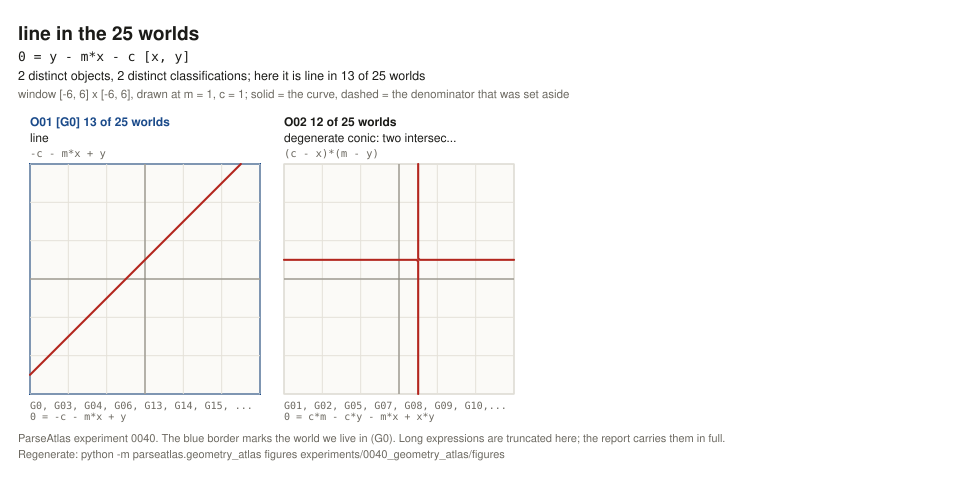

| object | worlds | canonical reading | classification | deg | ambient | `x*y` | denominator | grammars |
|---|---|---|---|---|---|---|---|---|
| `O01` | `13` | `-c - m*x + y` | line | `1` | `2` | no | - | `G0, G03, G04, G06, G13, G14, G15, G16, G17, G18, G20, G23, G24` |
| `O02` | `12` | `(c - x)*(m - y)` | degenerate conic: two intersecting lines | `2` | `2` | **yes** | - | `G01, G02, G05, G07, G08, G09, G10, G11, G12, G19, G21, G22` |

#### `circle` — `x*x + y*y - r*r` — `4` objects, `3` labels, `G0`'s group `9`

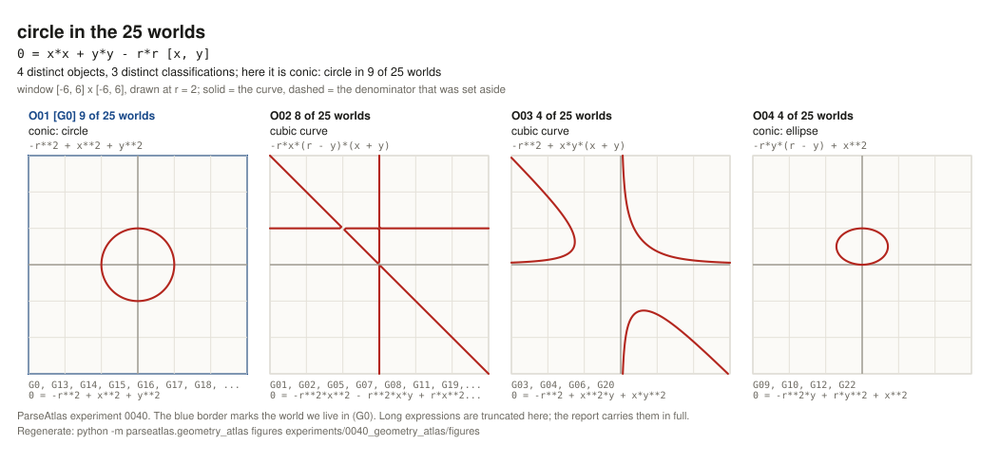

| object | worlds | canonical reading | classification | deg | ambient | `x*y` | grammars |
|---|---|---|---|---|---|---|---|
| `O01` | `9` | `-r**2 + x**2 + y**2` | conic: circle | `2` | `2` | no | `G0, G13, G14, G15, G16, G17, G18, G23, G24` |
| `O02` | `8` | `-r*x*(r - y)*(x + y)` | cubic curve (three straight lines) | `3` | `4` | **yes** | `G01, G02, G05, G07, G08, G11, G19, G21` |
| `O03` | `4` | `-r**2 + x*y*(x + y)` | cubic curve | `3` | `3` | no | `G03, G04, G06, G20` |
| `O04` | `4` | `-r*y*(r - y) + x**2` | conic: ellipse † | `2` | `3` | no | `G09, G10, G12, G22` |

† symbolic label: `conic (type set by the sign of B^2-4AC = -4*r)`; an ellipse for `r > 0`.

#### `ellipse` — `x*x/4 + y*y/9 - 1` — `13` objects, `5` labels, `G0`'s group `5`

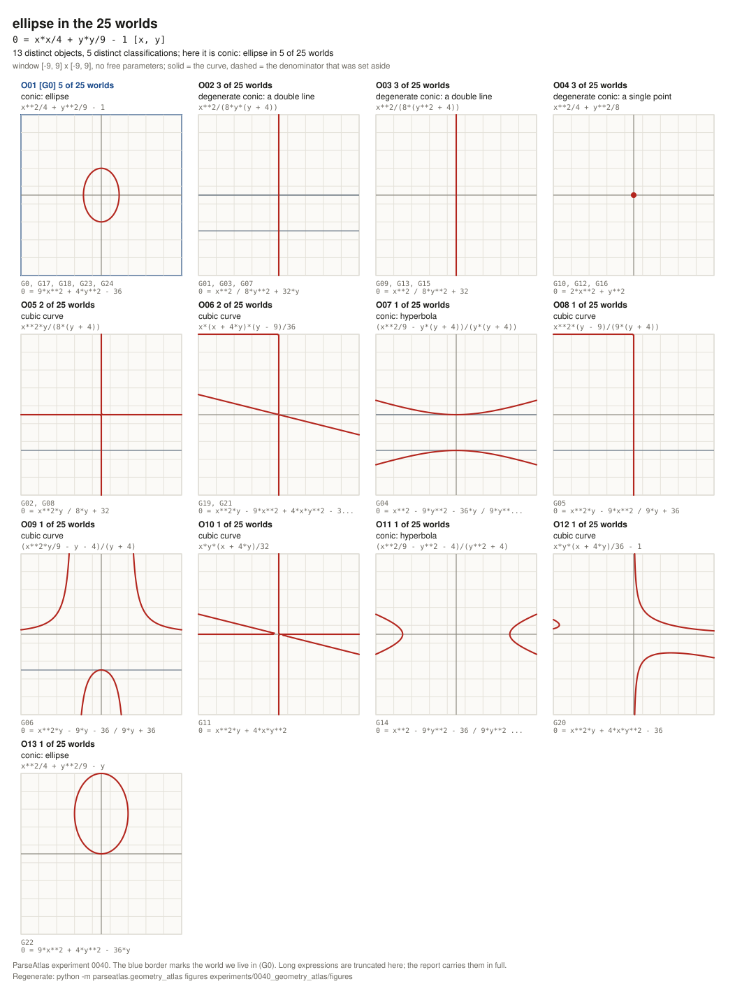

| object | worlds | canonical reading | classification | deg | `x*y` | denominator | grammars |
|---|---|---|---|---|---|---|---|
| `O01` | `5` | `x**2/4 + y**2/9 - 1` | conic: ellipse | `2` | no | `36` | `G0, G17, G18, G23, G24` |
| `O02` | `3` | `x**2/(8*y*(y + 4))` | degenerate conic: a double line | `2` | no | `8*y**2 + 32*y` | `G01, G03, G07` |
| `O03` | `3` | `x**2/(8*(y**2 + 4))` | degenerate conic: a double line | `2` | no | `8*y**2 + 32` | `G09, G13, G15` |
| `O04` | `3` | `x**2/4 + y**2/8` | degenerate conic: a single point | `2` | no | `8` | `G10, G12, G16` |
| `O05` | `2` | `x**2*y/(8*(y + 4))` | cubic curve (three lines) | `3` | no | `8*y + 32` | `G02, G08` |
| `O06` | `2` | `x*(x + 4*y)*(y - 9)/36` | cubic curve (three lines) | `3` | **yes** | `36` | `G19, G21` |
| `O07` | `1` | `(x**2/9 - y*(y + 4))/(y*(y + 4))` | conic: hyperbola | `2` | no | `9*y**2 + 36*y` | `G04` |
| `O08` | `1` | `x**2*(y - 9)/(9*(y + 4))` | cubic curve (three lines) | `3` | no | `9*y + 36` | `G05` |
| `O09` | `1` | `(x**2*y/9 - y - 4)/(y + 4)` | cubic curve | `3` | no | `9*y + 36` | `G06` |
| `O10` | `1` | `x*y*(x + 4*y)/32` | cubic curve (three lines) | `3` | no | `32` | `G11` |
| `O11` | `1` | `(x**2/9 - y**2 - 4)/(y**2 + 4)` | conic: hyperbola | `2` | no | `9*y**2 + 36` | `G14` |
| `O12` | `1` | `x*y*(x + 4*y)/36 - 1` | cubic curve | `3` | no | `36` | `G20` |
| `O13` | `1` | `x**2/4 + y**2/9 - y` | conic: ellipse | `2` | no | `36` | `G22` |

#### `hyperbola` — `x*x/4 - y*y/9 - 1` — `5` objects, `3` labels, `G0`'s group `9`

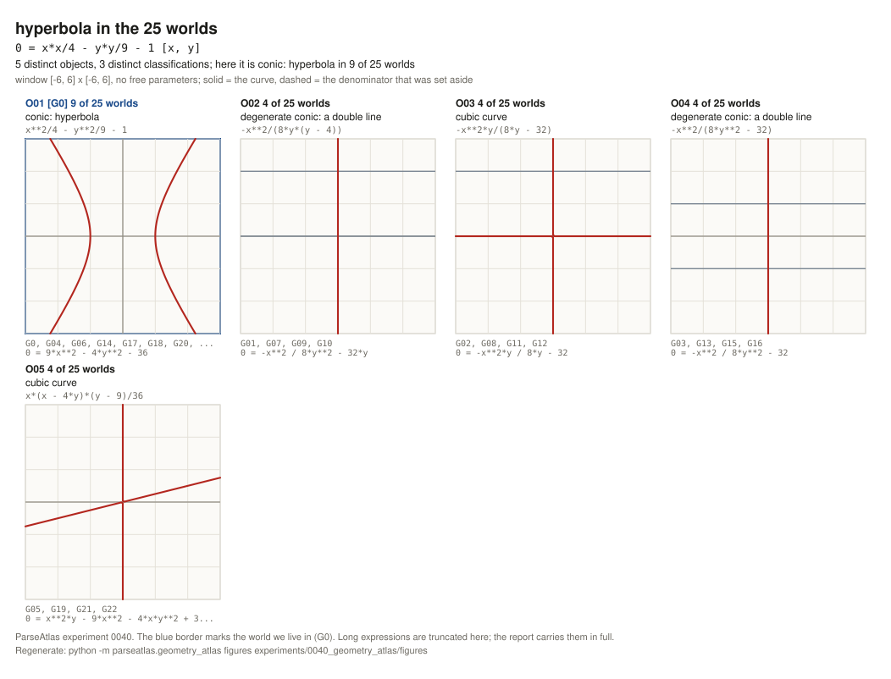

| object | worlds | canonical reading | classification | deg | `x*y` | denominator | grammars |
|---|---|---|---|---|---|---|---|
| `O01` | `9` | `x**2/4 - y**2/9 - 1` | conic: hyperbola | `2` | no | `36` | `G0, G04, G06, G14, G17, G18, G20, G23, G24` |
| `O02` | `4` | `-x**2/(8*y*(y - 4))` | degenerate conic: a double line | `2` | no | `8*y**2 - 32*y` | `G01, G07, G09, G10` |
| `O03` | `4` | `-x**2*y/(8*y - 32)` | cubic curve (three lines) | `3` | no | `8*y - 32` | `G02, G08, G11, G12` |
| `O04` | `4` | `-x**2/(8*y**2 - 32)` | degenerate conic: a double line | `2` | no | `8*y**2 - 32` | `G03, G13, G15, G16` |
| `O05` | `4` | `x*(x - 4*y)*(y - 9)/36` | cubic curve (three lines) | `3` | **yes** | `36` | `G05, G19, G21, G22` |

#### `parabola` — `y - a*x*x - b*x - c` — `2` objects, `2` labels, `G0`'s group `13`

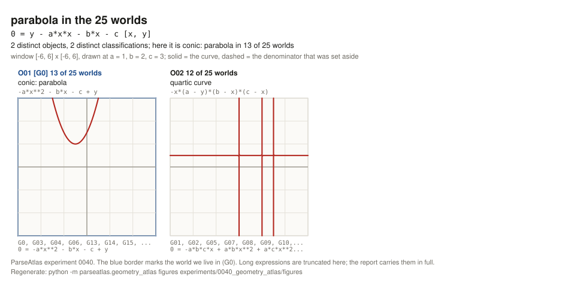

| object | worlds | canonical reading | classification | deg | ambient | `x*y` | grammars |
|---|---|---|---|---|---|---|---|
| `O01` | `13` | `-a*x**2 - b*x - c + y` | conic: parabola | `2` | `3` | no | `G0, G03, G04, G06, G13, G14, G15, G16, G17, G18, G20, G23, G24` |
| `O02` | `12` | `-x*(a - y)*(b - x)*(c - x)` | quartic curve (four straight lines) | `4` | `4` | **yes** | `G01, G02, G05, G07, G08, G09, G10, G11, G12, G19, G21, G22` |

#### `distance_components` — `(x - p)*(x - p) + (y - q)*(y - q) - d*d` — `4` objects, `3` labels, `G0`'s group `9`

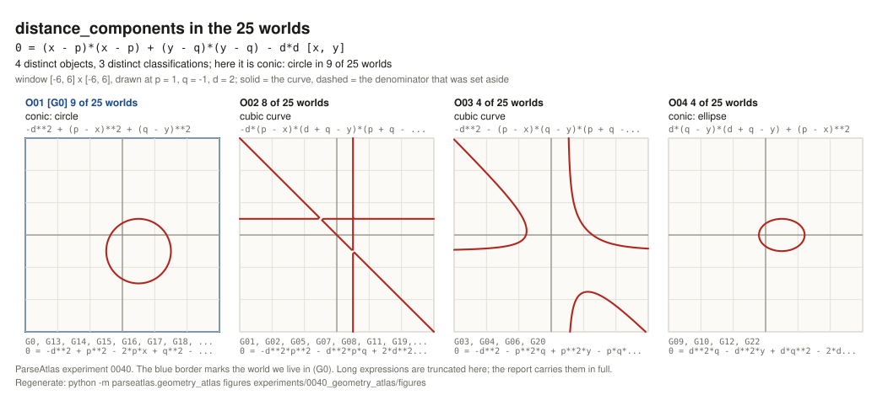

| object | worlds | canonical reading | classification | deg | ambient | `x*y` | grammars |
|---|---|---|---|---|---|---|---|
| `O01` | `9` | `-d**2 + (p - x)**2 + (q - y)**2` | conic: circle | `2` | `2` | no | `G0, G13, G14, G15, G16, G17, G18, G23, G24` |
| `O02` | `8` | `-d*(p - x)*(d + q - y)*(p + q - x - y)` | cubic curve (three lines) | `3` | `4` | **yes** | `G01, G02, G05, G07, G08, G11, G19, G21` |
| `O03` | `4` | `-d**2 - (p - x)*(q - y)*(p + q - x - y)` | cubic curve | `3` | `3` | **yes** | `G03, G04, G06, G20` |
| `O04` | `4` | `d*(q - y)*(d + q - y) + (p - x)**2` | conic: ellipse † | `2` | `3` | no | `G09, G10, G12, G22` |

† symbolic label: `conic (type set by the sign of B^2-4AC = -4*d)`.

#### `midpoint_component` — `x + y/2 - m` — `4` objects, `1` label, `G0`'s group `9`

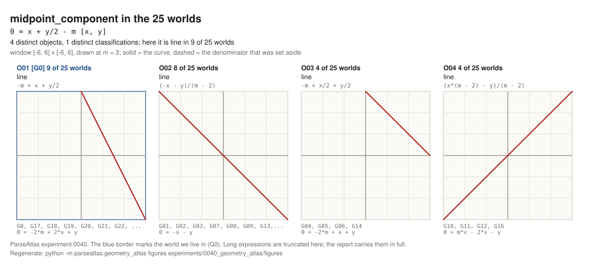

| object | worlds | canonical reading | classification | denominator | excluded points | grammars |
|---|---|---|---|---|---|---|
| `O01` | `9` | `-m + x + y/2` | line | `2` | - | `G0, G17, G18, G19, G20, G21, G22, G23, G24` |
| `O02` | `8` | `(-x - y)/(m - 2)` | line | `m - 2` | `m = 2` | `G01, G02, G03, G07, G08, G09, G13, G15` |
| `O03` | `4` | `-m + x/2 + y/2` | line | `2` | - | `G04, G05, G06, G14` |
| `O04` | `4` | `(x*(m - 2) - y)/(m - 2)` | line | `m - 2` | `m = 2` | `G10, G11, G12, G16` |

#### `slope_form` — `y - w/x - v` — `2` objects, `2` labels, `G0`'s group `13`

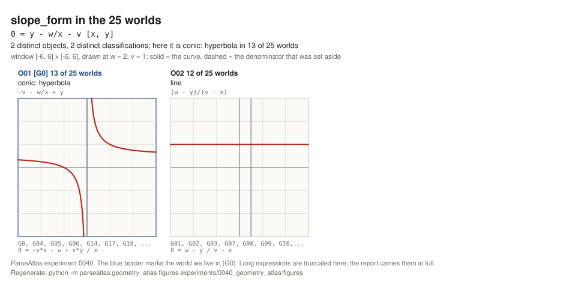

| object | worlds | canonical reading | classification | deg | `x*y` | denominator | excluded | grammars |
|---|---|---|---|---|---|---|---|---|
| `O01` | `13` | `-v - w/x + y` | conic: hyperbola | `2` | **yes** | `x` | `x = 0` | `G0, G04, G05, G06, G14, G17, G18, G19, G20, G21, G22, G23, G24` |
| `O02` | `12` | `(w - y)/(v - x)` | line | `1` | no | `v - x` | `v = x` | `G01, G02, G03, G07, G08, G09, G10, G11, G12, G13, G15, G16` |

#### `pythagorean_form` — `a*a + b*b - c*c` — `4` objects, `3` labels, `G0`'s group `9`

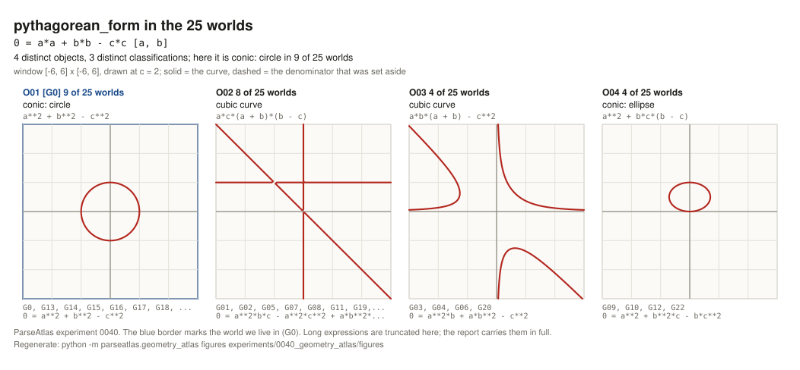

| object | worlds | canonical reading | classification | deg | ambient | cross | grammars |
|---|---|---|---|---|---|---|---|
| `O01` | `9` | `a**2 + b**2 - c**2` | conic: circle | `2` | `2` | no | `G0, G13, G14, G15, G16, G17, G18, G23, G24` |
| `O02` | `8` | `a*c*(a + b)*(b - c)` | cubic curve (three lines) | `3` | `4` | **yes** | `G01, G02, G05, G07, G08, G11, G19, G21` |
| `O03` | `4` | `a*b*(a + b) - c**2` | cubic curve | `3` | `3` | no | `G03, G04, G06, G20` |
| `O04` | `4` | `a**2 + b*c*(b - c)` | conic: ellipse † | `2` | `3` | no | `G09, G10, G12, G22` |

† symbolic label: `conic (type set by the sign of B^2-4AC = -4*c)`.

#### `trapezoid_area` — `(x + y)*h/2 - s` — `3` objects, `1` label, `G0`'s group `9`

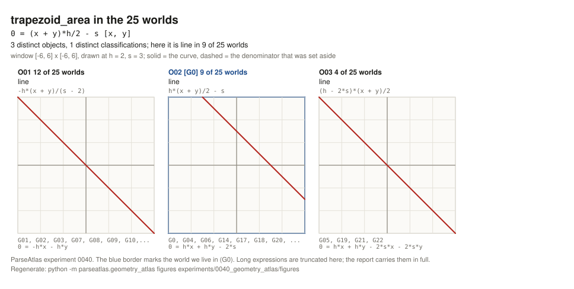

| object | worlds | canonical reading | classification | which line | grammars |
|---|---|---|---|---|---|
| `O01` | `12` | `-h*(x + y)/(s - 2)` | line | `x + y = 0` | `G01, G02, G03, G07, G08, G09, G10, G11, G12, G13, G15, G16` |
| `O02` | `9` | `h*(x + y)/2 - s` | line | `x + y = 2*s/h` | `G0, G04, G06, G14, G17, G18, G20, G23, G24` |
| `O03` | `4` | `(h - 2*s)*(x + y)/2` | line | `x + y = 0` | `G05, G19, G21, G22` |

#### `circle_through_origin` — `x*x + y*y - a*x - b*y` — `4` objects, `4` labels, `G0`'s group `9`

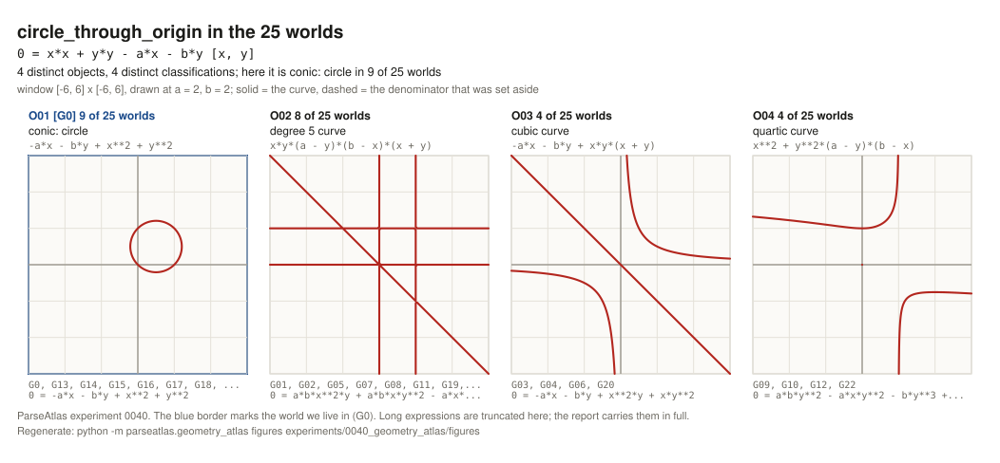

| object | worlds | canonical reading | classification | deg | grammars |
|---|---|---|---|---|---|
| `O01` | `9` | `-a*x - b*y + x**2 + y**2` | conic: circle | `2` | `G0, G13, G14, G15, G16, G17, G18, G23, G24` |
| `O02` | `8` | `x*y*(a - y)*(b - x)*(x + y)` | degree `5` curve (five straight lines) | `5` | `G01, G02, G05, G07, G08, G11, G19, G21` |
| `O03` | `4` | `-a*x - b*y + x*y*(x + y)` | cubic curve | `3` | `G03, G04, G06, G20` |
| `O04` | `4` | `x**2 + y**2*(a - y)*(b - x)` | quartic curve | `4` | `G09, G10, G12, G22` |

#### `degenerate_pair` — `(x - y)*(x + y)` — `1` object, `1` label, `G0`'s group `25`

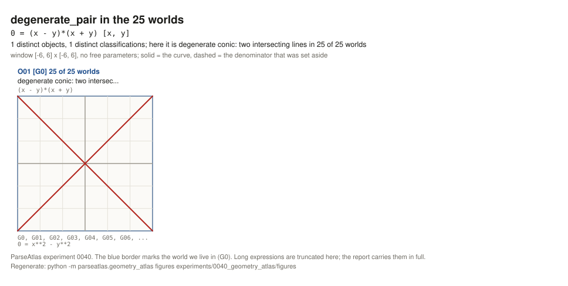

| object | worlds | canonical reading | classification | grammars |
|---|---|---|---|---|
| `O01` | `25` | `(x - y)*(x + y)` | degenerate conic: two intersecting lines | all `25` |

### 2. Aggregates

The distribution of the `300` cells by classification, and of the `48` distinct objects:

```text
label                                       cells / 300     objects / 48
line                                             75               9
cubic curve                                      56              15
degenerate conic: two intersecting lines         37               2
conic: circle                                    36               4
conic: hyperbola                                 24               4
conic: ellipse                                   18               5
quartic curve                                    16               2
degenerate conic: a double line                  14               4
conic: parabola                                  13               1
degree 5 curve                                    8               1
degenerate conic: a single point                  3               1
```

`17` distinct objects (`109` cells) are of degree `> 1` and are nonetheless unions of straight lines: one of the commonest consequences of a precedence permutation is that a curve **decomposes into a set of lines**. `71` cells carry an `x*y` cross term, and `49` cells carry a denominator that contains a coordinate — in those worlds these curves are punctured.

### 3. Survival: which geometry survives

`survival_report` asks: in how many worlds does a curve keep **its own classification** (the label of the control world). This is the geometric analogue of identity survival in `0036`.

| curve | written form | control label | survives | distinct objects | distribution of labels |
|---|---|---|---|---|---|
| `degenerate_pair` | `(x - y)*(x + y)` | degenerate conic: two intersecting lines | `25`/`25` | `1` | two intersecting lines `25` |
| `midpoint_component` | `x + y/2 - m` | line | `25`/`25` | `4` | line `25` |
| `trapezoid_area` | `(x + y)*h/2 - s` | line | `25`/`25` | `3` | line `25` |
| `line` | `y - m*x - c` | line | `13`/`25` | `2` | line `13` ; two intersecting lines `12` |
| `parabola` | `y - a*x*x - b*x - c` | conic: parabola | `13`/`25` | `2` | parabola `13` ; quartic `12` |
| `slope_form` | `y - w/x - v` | conic: hyperbola | `13`/`25` | `2` | hyperbola `13` ; **line `12`** |
| `circle` | `x*x + y*y - r*r` | conic: circle | `9`/`25` | `4` | cubic `12` ; circle `9` ; ellipse `4` |
| `circle_through_origin` | `x*x + y*y - a*x - b*y` | conic: circle | `9`/`25` | `4` | circle `9` ; degree `5` `8` ; cubic `4` ; quartic `4` |
| `distance_components` | `(x - p)*(x - p) + (y - q)*(y - q) - d*d` | conic: circle | `9`/`25` | `4` | cubic `12` ; circle `9` ; ellipse `4` |
| `hyperbola` | `x*x/4 - y*y/9 - 1` | conic: hyperbola | `9`/`25` | `5` | hyperbola `9` ; cubic `8` ; double line `8` |
| `pythagorean_form` | `a*a + b*b - c*c` | conic: circle | `9`/`25` | `4` | cubic `12` ; circle `9` ; ellipse `4` |
| `ellipse` | `x*x/4 + y*y/9 - 1` | conic: ellipse | `6`/`25` | `13` | cubic `8` ; ellipse `6` ; double line `6` ; single point `3` ; hyperbola `2` |

Three observations from this table that the numbers alone do not show.

**A surviving classification is not a surviving object.** `midpoint_component` is a line in all `25` worlds and is nonetheless `4` different objects: `x + y/2 = m`, `x + y = 0`, `(x + y)/2 = m` (this one is the genuine mean of the two), and `x = y`. Two of them lose `m` altogether. The same holds for `trapezoid_area`: a line in all `25` worlds, but `16` worlds (`12 + 4`) read the line `x + y = 0`, in which the area `s` is no longer present at all, and only `9` worlds read the straight line `x + y = 2*s/h`. The label survived; the geometry did not.

**`ellipse` is the only entry where a reading with the same label exists outside `G0`'s group.** `survives = 6` while `G0`'s group is `5`: `G22` reads a separate object (`x**2/4 + y**2/9 - y`), which is an ellipse all the same. That difference is exactly the difference between survival and object identity.

**One curve runs in the opposite direction.** `slope_form` is a hyperbola in `G0` (with an `x*y` term), while in `12` worlds it is a **line**. So a precedence permutation does not always destroy geometry — it redistributes difficulty. In those `12` worlds the slope formula between two points is a simpler object than it is for us.

### 4. Where `G0` stands

`G0`'s group size on each curve:

```text
degenerate_pair 25 | line 13 | parabola 13 | slope_form 13
circle 9 | hyperbola 9 | distance_components 9 | midpoint_component 9
pythagorean_form 9 | trapezoid_area 9 | circle_through_origin 9
ellipse 5
```

`G0` **stands alone on no curve**; its minimal group is `5`. Agreement with `G0`, out of `12` curves:

```text
G0  12   G01  1   G02  1   G03  3   G04  6   G05  2   G06  6   G07  1   G08  1
G09  1   G10  1   G11  1   G12  1   G13  7   G14 10   G15  7   G16  7   G17 12
G18 12   G19  3   G20  7   G21  3   G22  3   G23 12   G24 12
```

`4` worlds — `G17` (`* > / > + > -`), `G18` (`* > / > - > +`), `G23` (`/ > * > + > -`), `G24` (`/ > * > - > +`) — read the entire catalogue exactly as `G0` does. All four are orderings that leave both `*` and `/` above both additive operators, that is, they order `G0`'s tied level strictly in a way that does not break the existing tie. On this catalogue `G0` is an ordinary member of that group of five.

## Figures

`12` SVGs, one per catalogue curve, in `experiments/0040_geometry_atlas/figures/`. Each holds **every** distinct reading of that curve side by side, one panel apiece with its classification and world count, so that a reader sees at a glance that our circle is four different things.

**Regeneration command:**

```text
python -m parseatlas.geometry_atlas figures experiments/0040_geometry_atlas/figures
```

The same command is written on the last line of each figure. The headline numbers:

```text
python -m parseatlas.geometry_atlas headline
```

**Why the SVG is written out directly as text.** `matplotlib` and `numpy` are not installed, and the project depends deliberately on `sympy` alone. SVG written in pure Python is dependency-free, diffs in git, renders on GitHub and is regenerable — which is precisely this repository's discipline. A figure that cannot be regenerated is not evidence.

**How a curve is drawn.** An implicit curve is drawn by sampling the sign of the expression on a grid and running a marching-squares contour at level `0`, in pure Python (`zero_set_segments`, `145 x 145` nodes). Three details have to be stated separately:

- What is drawn is the zero set of the **numerator** and not of the rational reading itself. The numerator is a polynomial and continuous, so the tracer never has to jump over a pole. The denominator's own zero set is laid over it as a dashed line by the same tracer — that is the locus removed from the curve.
- What is drawn is the **square-free part** of the numerator. The zero set does not change under this, but a repeated factor touches zero without a change of sign, and a tracer that works only on sign changes would draw nothing. `x*x` is a double line and must be drawn as a line.
- **A zero set that is a single point is not drawn by sampling — it is solved.** `x*x/4 + y*y/8` vanishes only at the origin and no grid edge changes sign there. Sampling cannot repair this: whether or not the grid lands exactly on that point is not a property of the curve. The classification has already named this case (`degenerate conic: a single point`), and for a conic that point is the centre — the simultaneous zero of the two partial derivatives, `2*A*x + B*y + D` and `B*x + 2*C*y + E`, that is, a single exact linear solve (`single_point`).

The panels are drawn at the catalogue's declared parameter values; the classification is of the symbolic form. Every panel of every figure draws something — this is fixed by a test **at both grid parities**, because a panel that draws only when the grid happens to meet the curve is not drawn, it is merely lucky. An empty panel would mean the parameter landed on a singular locus.

Every SVG has an explicit background `rect` and an explicit `fill`/`stroke` on every mark, because an artifact and a README both render on either ground, and an unpainted SVG is invisible on one of them. Axes, ticks and labels stay inside the viewBox: the width of a figure follows from its longest line of text, and text inside a panel is clipped to the available pixels. Both are fixed by tests.

## Multicore

Repository policy is multicore by default, by a measured decision. The unit of work is a single `(curve, world)` **cell** and not a curve: a pool of `12 x 25 = 300` items distributes far better than one of `12`. The worker count comes from `resolve_worker_count`, `cpu_count - 1` (`15` on this host, `16` cores), with one core of headroom for the interactive session; there is no hardcoded constant anywhere.

**Measurement A — `parallelism_measurement`, the full `12`-curve catalogue, `25` grammars, `3` independent runs, each in a clean interpreter:**

```text
run   sequential_s   parallel_s   speedup   workers   identical_results
 1        9.32          3.71        2.51       15          true
 2        7.26          3.67        1.98       15          true
 3        7.62          4.03        1.89       15          true

cpu_count 16 | item_count 300 | automatic_worker_count 15 | faster_path: parallel (3/3)
```

Parallel wins on all three runs, so the default is parallel.

**Measurement B — why the speedup is `2` and not `15`.** The pool's own startup was measured separately — `15` workers, spawn start method, `300` trivial items, where each worker imports `parseatlas.geometry_atlas` and with it `sympy`:

```text
pool startup (15 workers, sympy import included)     2.82 s
parallel wall clock (measurement A)             3.67 - 4.03 s
```

That is, `~2.8 s` of the parallel wall clock is startup and only `~1 s` is real work, whereas the same work sequentially is `7.3 - 9.3 s`. Parallelism is doing its job; at this catalogue's size the building of the pool dominates, and on a larger catalogue the speedup would be considerably higher.

**Measurement C — the decomposition ceiling.** The individual costs of the cells (`300` cells, sequential, one process):

```text
total                    7.97 s
median cell              0.021 s
slowest cell             0.189 s   (line, G0)
total / slowest          42.3
```

A ceiling of `42` stands far above `15` workers, so the unit of work is fine-grained enough and the limit is the worker count and the pool overhead, not any indivisible cell. This agrees with measurements A and B.

Parallelism changes the speed only — `identical_results` checks this directly by comparing object ids, canonical forms, labels, degrees, cross-term flags and grammar lists, rather than by assumption; `true` on all three runs.

## Interpretation

The geometric answer to the founding question, in one sentence: **in almost half the worlds the string we call a line does not denote a line.**

This is sharper than the algebraic result of `0035`, for two reasons. First: a classification is a coarse label. A change of coefficient may be immaterial; `line` -> `degenerate conic` is not. Second: in geometry an object can be drawn, and a picture does not argue. The four panels of `figures/circle.svg` show one and the same written form, and only one of them is a circle.

The mechanism is the same everywhere: `x*x` and `y*y` are squares only because `*` stands high. When `*` comes down, `x*x + y*y` is no longer a sum of two squares but an altogether different product, and that product often **factors**: of the `48` distinct objects, `17` are unions of straight lines. This is the most unexpected structural result of the experiment — a precedence permutation does not merely distort a curve, it decomposes it into linear components. `x*x + y*y - r*r` is three straight lines in `8` worlds; `y - a*x*x - b*x - c` is four in `12`; `x*x + y*y - a*x - b*y` is five in `8`.

In those worlds the theory of conic sections would not have been written in this form. The discriminant `B^2 - 4*A*C` is an instrument for a degree-`2` object; in those worlds the written form that gives us a conic gives a cubic or a set of lines, and some other string would be the cheapest way to obtain a conic. That string is the one that would have become "the equation of a circle".

On the other hand, genuine convention-independent geometry does exist, and it lies exactly where the notation leaves no choice: `(x - y)*(x + y)` is fully parenthesized and identical in all `25` worlds. The conclusion of `0035` repeats here exactly — notation does not decide everything; it decides where mixed operators raise the question of precedence.

And finally, `G0` is not privileged here either. `4` complete twins, no curve on which it stands alone, and on `ellipse` it sits in a group of `5` out of `25`. In this measurement too, the conventional order is an ordinary member.

```text
written form -> grammar -> curve -> classification -> drawing
```

## Limits

- **The classification is of the numerator and not of the reading itself.** The expression is put over a common denominator and the label is given to the numerator; the denominator is recorded separately (`denominator`, `denominator_punctures`, `excluded_locus`) and drawn on the figure as a dashed line. This is geometrically correct — the zero set of `N/D` is the zero set of `N` minus the poles — but it means that the label describes the curve **without its punctures**. `x**2/(8*y*(y + 4))` is the double line `x = 0` with two points removed; the label does not name those two points.
- **The conic labels do not separate the real locus from the imaginary one.** The rule is the bare discriminant, so `x*x + y*y + 4` receives the label `conic: circle` even though its **real zero set is empty**. The standard classification separates these cases by `sign((A+C)·det)`; we do not have that. Review checked separately that this **never fires** on this deliverable: all 300 cells were checked at the declared parameters, and a conic label with an empty real locus occurs **0 times**, so not one number, table row or figure changes. On another catalogue it would arise.
- **The catalogue is hand-chosen.** The `12` entries reflect a judgement about what counts as standard in geometry. Another choice would have given another ratio of invariant to fractured. In particular, `degenerate_pair` was added deliberately in order to test whether an invariant curve exists at all — this is not a random sample.
- **Generation 1 has no exponentiation, so squares are written as products.** `x*x` is the only expressible form of `x**2` in this grammar, and that is exactly what leaves it undefended against precedence. In a grammar with `**`, `x**2 + y**2 - r**2` would very likely be far more stable, and that question is a different experiment.
- **A curve whose class has changed is not a worse curve.** It is **a different object**, the one that world would have studied. `-r*x*(r - y)*(x + y)` is three straight lines and a perfectly respectable geometric object; it simply is not a circle. Nowhere does this report say that the conventional order is better.
- **Degree is counted in the coordinates.** The parameters (`r`, `m`, `c`, `d`, ...) do not raise the degree, because they name a family and not a direction in the plane. The ambient degree is in a separate column, and the manager probe's circle labels are recovered from precisely that column; the two conventions give different labels and the same object counts.
- **Conditional labels depend on the sign of a parameter.** The symbolic discriminant of `3` readings is `-4*r`, `-4*d`, `-4*c`, whose signs do not follow from the real-parameter assumptions. A label marked `†` in the tables is the one decided at the catalogue's declared values (`r, d, c > 0` -> ellipse); at negative values the same reading is a hyperbola.
- **Degeneracy is identical vanishing.** A determinant that can vanish at a particular parameter (`-r**2`) leaves the curve non-degenerate, and the locus is recorded separately. This is a choice and not a theorem; at `r = 0` the circle really is a point.
- **The figures are sampling.** Marching squares works on a `145 x 145` grid and approximates the curve by polylines. Between nodes it says nothing, and a sharp cusp or two very close branches below the grid resolution will be lost. The isolated-zero fallback shows only those nodes the grid landed on exactly.
- **The window is chosen.** Every figure is `[-6, 6] x [-6, 6]`, except `ellipse`, which is `[-9, 9]`, because one of its readings is a hyperbola with vertices at `x = +-6`. Another window would show a different part of the curve; the classification does not depend on the window, but the picture does.
- **`domain` is inert in the semantic key** (`NF-2026-00005`). The triple `(canonical, domain, excluded points)` is the project's own and is used here unchanged, by import, but `canonical.py` always sets `domain` to `"R"`, so the discrimination that actually takes place has two components. No count in this experiment changes because of it — all `48` distinct objects correspond to `48` different canonical texts, so not even the excluded points were needed in the role of separator — but the guarantee has to be stated as it is.
- **Excluded points follow the project's convention.** `canonical.undefined_terms` solves the denominator with respect to the alphabetically first variable, so the excluded point of the `12`-world reading of `slope_form` is written as `v = x` and not `x = v`. This is a property of the key and is taken over unchanged.
- **The speedup was measured on one host** (`16` cores, Windows, spawn start method). On another host the number will be different; the decision has to be re-measured and not copied over.

## Classification of evidence

- **Observations** (executable, reproducible in this repository): the `13`/`12` split of the line and the `x*y` term of the dissenting group; the `4` objects of the circle and the `9 | 8 | 4 | 4` split; `48` distinct objects over `300` cells; the per-curve survival counts; the `17` objects that are unions of lines; `G0`'s group sizes and its `4` twins; the distribution of labels; the panel counts of the figures; the multicore timings.
- **Interpretation** (derived from what was measured and not itself measured): the claim that the geometers of those worlds would have studied **these** objects and would have built the theory of conic sections on a different written form. This is a notational-cost argument and not a measurement.
- **Not claimed**: that the conventional order is better or worse; that any universal law of the `24 + 1` worlds exists; that the catalogue is a representative sample of geometry as a whole; that any world's reading is a more or a less "real" curve.

## Validation

```text
tests/test_geometry_atlas.py: 33 passed
full suite:                  841 passed   (755 when this card was run; the difference
                                           is exactly the tests of two parallel cards)
```

Pins in `tests/test_geometry_atlas.py`:

```text
test_the_circle_is_four_different_objects_and_ours_is_the_nine_world_group
test_in_twelve_of_twenty_five_worlds_the_equation_of_a_line_is_not_a_line
test_classify_names_a_circle_an_ellipse_and_a_hyperbola_by_hand_checked_discriminants
test_classify_names_the_parabola_and_the_four_degenerate_conics
test_classify_refuses_a_label_it_cannot_justify_and_says_which_sign_decides_it
test_a_determinant_that_can_vanish_is_not_the_same_as_one_that_does
test_classify_counts_degree_in_the_coordinates_and_reports_the_ambient_degree_separately
test_classify_sets_the_denominator_aside_instead_of_dying_on_it
test_classify_never_crashes_anywhere_in_the_full_sweep
test_the_key_still_carries_excluded_points_even_though_they_split_nothing_here
test_every_svg_the_report_references_exists_and_is_not_empty
test_every_figure_is_well_formed_paints_its_own_ground_and_stays_inside_the_viewbox
test_every_panel_of_every_figure_actually_draws_something
test_the_single_point_panel_draws_its_point_at_either_grid_parity
test_the_saddle_cell_pairs_its_four_crossings_by_the_centre_value
test_the_sequential_and_parallel_paths_produce_the_same_atlas
```

`test_classify_never_crashes_anywhere_in_the_full_sweep` is the test that closes the earlier probe's failure: it reads the `12` curves in all `25` grammars — `300` cells — and demands a non-empty label and family on each. That sweep includes the rational readings of the hyperbola, which are precisely the ones `Poly` would have failed on.

Mutation testing was carried out on an **isolated copy**: `src/parseatlas`, the test file and `experiments/0040_geometry_atlas/` were copied into a scratch tree, `PYTHONPATH` was pointed at that copy (which is verified at the start of the run through `parseatlas.__file__`), and each mutation was run separately. The repository was not touched.

```text
BASELINE                                                                       33 passed
KILLED   classification switched to the ambient degree over all free symbols     7 failed
KILLED   the denominator is dropped instead of being set aside                   1 failed
KILLED   a conditional label is guessed instead of refused                       2 failed
KILLED   degeneracy decided by "can vanish" instead of "vanishes identically"    3 failed
KILLED   the circle test drops A == C, so every ellipse becomes a circle         5 failed
KILLED   the discriminant sign inverted (ellipse and hyperbola swapped)          7 failed
KILLED   the double-line refinement dropped (a repeated factor reads parallel)   2 failed
KILLED   the square-free part dropped, so a double line draws nothing            2 failed
KILLED   the exact single-point solve removed from the panel                     2 failed
KILLED   the semantic key reduced to canonical text alone                        6 failed
KILLED   the semantic key drops excluded points                                  1 failed
KILLED   object groups ordered smallest first                                    8 failed
KILLED   worker count loses the core headroom                                    1 failed
KILLED   the SVG background rect is dropped                                      1 failed
KILLED   panel text is emitted unclipped, so it runs past the viewBox            1 failed
KILLED   the marching-squares saddle case pairs the crossings the other way      1 failed
KILLED   the domain component of the key silently changed ("R" -> "CONSTANT")    3 failed
SURVIVED (expected)  domain replaced by the constant it always is ("R" -> "R")

17/18 mutants killed
```

The one survivor is deliberate and is the evidence for `NF-2026-00005`: replacing `canonical["domain"]` in `semantic_key` with the literal `"R"` leaves all `33` tests green, because `domain` really never changes. The two mutants standing next to it do die: the one that gives `domain` a **different** value (`"CONSTANT"`), and the one that reduces the key entirely to the canonical text — so the field is indeed read, it simply distinguishes nothing.

`the semantic key drops excluded points` survived on the first run, and a targeted test was added for it (`test_the_key_still_carries_excluded_points_even_though_they_split_nothing_here`), which pins both: that the key really does carry excluded points (the `G0` reading of `slope_form` has `x = 0`), and the measured fact that on **this** catalogue they split no two objects, because all `48` objects already have their own canonical text (`restriction_split_objects = 0`).
